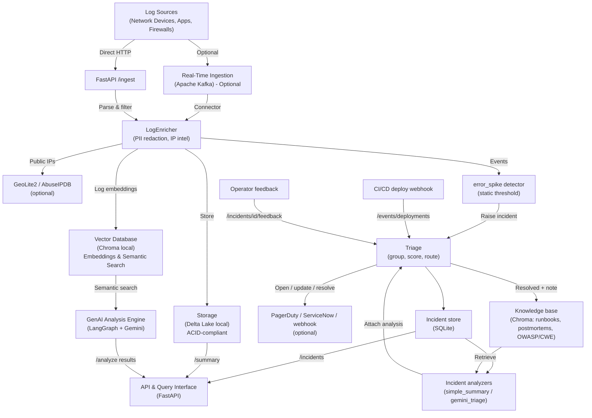

# Serverless-GenAI-Log-Analyzer

### Abstract

This project is a local-first prototype of a **Generative AI-powered Network Log Analyzer**: it ingests logs, redacts PII, stores them, raises incidents on error spikes, and (optionally) uses an LLM to summarize and triage those incidents. It works end to end, but it is a prototype, not a production system. See [Known Limitations](#known-limitations).

A **FastAPI** backend orchestrates the **Gemini API** via **LangChain/LangGraph**. The app is containerized with **Docker**, and the image is compatible with serverless platforms such as **Google Cloud Run**. No live deployment is maintained, and Cloud Run deployment is not automated.

**Continuous Integration** runs on **GitHub Actions**: on every push to `main` it runs `ruff`, a `py_compile` import check on `api/main.py`, and the pytest suite (see [Testing](#testing)), then builds and publishes a Docker image to the GitHub Container Registry (GHCR). There is no Continuous Deployment.

Note: _This repo currently implements a lightweight, serverless FastAPI service with modular plugins (connectors/detectors/analyzers). Streaming ingestion is through the opt-in Kafka connector, or, for high volume, the opt-in Spark Structured Streaming job (see "Real-Time Ingestion" below). Managed/cluster deployments remain part of the **future scale-out plan**._

## Purpose

On-call engineers face thousands of near-identical log lines that often contain personal data. This prototype turns error bursts into single routed incidents, and redacts PII before storage. A slow NER model finds names, the system learns where they appear, and a reviewer approves the proposed rule once, so the high-volume Spark path catches them without NER. For the pitch and a step-by-step walkthrough, see [docs/DEMO.md](./docs/DEMO.md).

## Implemented Now (MVP)

- **FastAPI API** with `GET /`, `POST /ingest`, `POST /analyze`, `GET /plugins`, `GET /incidents`, `GET /incidents/{id}`, `POST /incidents/{id}/feedback`, `GET /feedback`, `POST /events/deployments`, `GET /deployments`, `POST|GET /knowledge`, `DELETE /knowledge/{id}`, `POST /search`, `GET /summary`, `GET /audit-trail`, `GET /metrics`, `GET /admin/integrations`
- **Modular plugin system** via `ENABLED_CONNECTORS`, `ENABLED_DETECTORS`, `ENABLED_ANALYZERS`
- **Plugin loading** via `PLUGIN_MODULES` (derived-image friendly)
- **Error-spike detection** (`error_spike`) that raises incidents into a **SQLite incident store** (`INCIDENTS_DB`), with analyzer outputs attached
- **Incident triage** (see [Incident triage](#incident-triage)): grouping, rule-based severity scoring, ownership routing, deployment correlation, operator feedback, and a runbook/postmortem knowledge base used by `gemini_triage`
- **PII redaction** (rule-based, plus optional NER when the spaCy model is installed), **Delta Lake** storage, **Chroma** vector search
- **Prometheus metrics** and a local Grafana dashboard
- **Opt-in Kafka connector** (`aiokafka`) with batched ingestion, and a single-node broker in `docker-compose.yml`
- **IP enrichment** (see [Enrichment](#enrichment)): GeoLite2 country and AbuseIPDB reputation for public IPs; malicious IPs raise severity
- **Ticketing** (see [Ticketing](#ticketing)): PagerDuty, ServiceNow and a signed generic webhook, opened/updated/resolved from incident changes
- **OWASP Top 10 / CWE reference docs** seeded into the knowledge base by `scripts/load_owasp_cwe.py`
- **API-key issuance**: keys stored in SQLite (hashed), issued per profile with scopes and expiry, revocable via CLI or `/admin/keys`

## Known Limitations

- **Detection is a static threshold**: one detector counts `ERROR`/`CRITICAL` logs in a sliding window. There is no learned baseline and no prediction. Grouping joins hits that share a source within `INCIDENT_GROUP_WINDOW_SECONDS`; it does not detect causal links between services.
- **Severity weights are hand-set**: the factors in `core/severity.py` are not fitted to historical data. Feedback is stored (`GET /feedback`) but nothing retrains on it yet; false positives only lower the score of later incidents on the same service.
- **LLM triage is unverified**: there is no correctness measurement. Retrieved runbooks/postmortems are listed under `references` in each analysis, but the model's use of them is not checked.
- **Routing is a static file**: `config/ownership.yaml` is read at startup. There is no on-call schedule. PagerDuty and ServiceNow tickets are sent, but routing keys and assignment groups are mapped per team through env vars, not synced from those systems.
- **Ticketing is not verified against live providers**: the dispatcher and webhook signing are unit-tested with fakes; no real PagerDuty or ServiceNow instance was called.
- **No remediation**: no automated actions.
- **Enrichment is limited**: GeoIP country and AbuseIPDB reputation only. There is no CMDB lookup. AbuseIPDB's free tier (1,000 checks/day) caps how many new IPs are checked.
- **PII redaction quality is not measured**: there is no evaluation set. Without the spaCy model it runs in rules-only mode and will not catch names.
- **Storage is local disk** (`./data/delta-lake`, `./data/chroma`), so it is ephemeral on serverless platforms.
- **Auth is off by default** (`ENABLE_AUTH=false`).
- **Verified end to end (local, 2026-10-12)**: Kafka → Spark → API → incident through the `spark_candidates` connector, and the Prometheus/Grafana stack, with ticket dispatch off. **Not verified**: ticketing (PagerDuty, ServiceNow and webhook are only tested with fakes) and the API's own `kafka` log connector under load.
- **No fallbacks**: if the redactor, Delta Lake, or Chroma cannot start, the API refuses to start. Without `GEMINI_API_KEY`, `POST /analyze` returns 503.
- **Test coverage is thin**: 84 tests cover the API, auth and rate limiting, key issuance, audit logger, redactor, error-spike detector, triage, ticket dispatch, webhook signing and IP enrichment. There are no tests for the Kafka connector, analyzers, or the LLM path.

## System Architecture



*(Note: See [ARCHITECTURE.md](./ARCHITECTURE.md) for the planned future scale-out architecture featuring Spark/Flink and managed cloud services.)*

## Key Features

- **Modular DI**: All core components (redactor, storage, vector store, engine) are injected via constructor. There are no null fallbacks.
- **Scale-out path**: a Spark Structured Streaming job (`spark/`, local mode in Docker) handles Kafka → Delta Lake and windowed spike detection. It has been run end-to-end locally but not load-tested; cluster deployment is described in `ARCHITECTURE.md` as a plan.
- **Security controls**: PII masking, scoped API keys (off by default, see [API Keys](#api-keys)), and structured audit logging.
- **Append-mode storage and audit trail**: logs are written to Delta Lake in append mode, and API calls are recorded in an audit trail.
- **Audit-aware PII tracing**: ingestion and audit events persist `contains_pii` so the API can expose redaction status directly.
- **Natural-language queries**: `POST /analyze` runs a LangGraph retrieval workflow over the vector store. It needs `GEMINI_API_KEY`; otherwise it returns 503.
- **Container-ready**: the image can run on Cloud Run, but state is on local disk (see Known Limitations).

---

## Architecture Overview

See [ARCHITECTURE.md](./ARCHITECTURE.md) for detailed component responsibilities, data flow, scaling strategies, and security controls.

---

## Quick Start

### 1. Installation
This project uses `uv` for lightning-fast dependency management.
```powershell
uv sync --extra dev
uv run python -m spacy download en_core_web_sm
```

> [!NOTE]
> uv-created virtualenvs do not include `pip`, which `spacy download` needs; if that command fails with "No module named pip", run `uv pip install pip` first. If the model cannot be installed, the app still starts and redacts in **rules-only** mode (names are not caught). Each log's `redaction_mode` field shows which mode was used.

### 2. Environment Setup
Copy the example environment file and fill in your keys (a `GEMINI_API_KEY` is required for the LLM analyzer to work):
```powershell
cp .env.example .env
```
Ensure your `.env` has the necessary values:
```env
GEMINI_API_KEY=your_key_here
LANGCHAIN_TRACING_V2=false   # set true only if you want prompts/logs sent to LangSmith
LANGCHAIN_API_KEY=your_langchain_api_key_here
KAFKA_BOOTSTRAP_SERVERS=localhost:9092
LOG_TOPIC=logs-raw
VECTOR_DB_TYPE=chroma
CHROMA_PATH=./data/chroma
DELTA_LAKE_PATH=./data/delta-lake
ENABLE_AUTH=false
API_KEYS_DB=./data/api_keys.sqlite3
```

### 3. Running the API
```powershell
uv run uvicorn api.main:app --reload --reload-dir api --reload-dir core --reload-dir processing --reload-dir engine --reload-dir storage --reload-dir vector_db
```

### 4. API Keys

With `ENABLE_AUTH=true`, every request needs an `X-API-Key` header. Keys are stored in SQLite at `API_KEYS_DB`. Only a hash of each secret is stored, and the raw key is shown once, when it is issued.

Each key is issued from a **profile**, which sets its scopes and default expiry:

| Profile | Scopes | Default TTL |
|---|---|---|
| `admin` | all, including `keys:admin`, `pii:admin` and `audit:read` | 30 days |
| `analyst` | ingest, search, analyze, read incidents/summary/plugins, `incidents:feedback`, `knowledge:write` | 90 days |
| `ingest-service` | `logs:ingest` | 365 days |
| `deploy-webhook` | `events:write` | 365 days |
| `viewer` | read incidents/summary/plugins | 180 days |

Bootstrap the first admin key with the CLI, then manage others through the CLI or the API:
```powershell
uv run python scripts/manage_keys.py profiles
uv run python scripts/manage_keys.py issue --name ops-admin --profile admin
uv run python scripts/manage_keys.py list
uv run python scripts/manage_keys.py revoke <key_id>
```
- `POST /admin/keys` (`{"name": ..., "profile": ..., "ttl_days": ...}`), `GET /admin/keys`, `DELETE /admin/keys/{key_id}` — all need `keys:admin`.
- `POST /admin/keys` also needs `ENABLE_AUTH=true` and returns 403 otherwise: with auth off every caller is anonymous, and a key minted then would stay valid once auth is on. Use the CLI to bootstrap.
- Each key records `issued_by`: the issuing key (`name:key_id`) for the API, `cli:<os user>` for the CLI. It is shown by `manage_keys.py list` and `GET /admin/keys`. PII rule decisions record the deciding key the same way.
- `GET /admin/pii-rules?status=pending|approved|rejected|collecting|all` and `POST /admin/pii-rules/decisions` (`{"ids": [...], "status": "approved"|"rejected"|"pending"}`) need `pii:admin`. See [PII rule suggestions](#throughput-settings).
- Expired or revoked keys get 401. A valid key without the needed scope gets 403.

---

## Docker (Plug-and-Play)

This project builds one container image per component (API and Spark job) from a single multi-stage `dockerfile`, and you can run them locally. The image is compatible with serverless platforms such as Cloud Run, but this repo does not deploy it anywhere.

### Build

```powershell
docker build --target api   -t genai-log-analyzer .         # API (also the default for a plain `docker build .`)
docker build --target spark -t genai-log-analyzer-spark .   # Spark Structured Streaming job
```

`dockerfile` is multi-stage with one target per component. Dependencies are installed into a virtualenv in a builder stage, and the runtime stage copies only that venv. The `api` image installs `requirements/full.txt` and has no Java. The `spark` image installs `requirements/spark.txt` plus Java 21, and has no spaCy or Chroma. Compose picks the target for each service. There is no reduced API image, because the API does not start without the redactor, Delta Lake, and Chroma.

### Runtime modularity (env vars)

Modules are activated at runtime via env vars:

- **`ENABLED_CONNECTORS`**: `kafka`, `spark_candidates`
- **`ENABLED_DETECTORS`**: `error_spike`
- **`ENABLED_ANALYZERS`**: `simple_summary`, `gemini_triage`

Plugin loading:
- **`PLUGINS_DIR`**: directory added to `sys.path` for plugin modules (default: `/app/plugins`)
- **`PLUGIN_MODULES`**: comma-separated Python module names to import; each module may define `register(registry)`

Example (run detector + analyzer locally):

```bash
# bash/zsh (in PowerShell, replace each trailing "\" with a backtick, or put the command on one line)
docker run -p 8001:8000 \
  -e ENABLED_DETECTORS=error_spike \
  -e ENABLED_ANALYZERS=simple_summary \
  -e ERROR_SPIKE_THRESHOLD=5 \
  genai-log-analyzer
```

Validation endpoints:
- `GET /plugins`
- `GET /incidents`

### Proactive detector tuning (error spike)

The built-in `error_spike` detector raises an incident when it sees a spike of `ERROR`/`CRITICAL` logs.

Env vars:
- **`ERROR_SPIKE_THRESHOLD`**: number of error events required to raise an incident
- **`ERROR_SPIKE_WINDOW_SECONDS`**: sliding window for counting errors
- **`ERROR_SPIKE_COOLDOWN_SECONDS`**: minimum seconds between incidents (dedup); set to `0` to disable cooldown (every error above the threshold then raises a new incident). The window is not cleared when an incident fires, so an incident's `count` is the real number of errors in the window.

### Incident analyzers

Analyzers run only when a new incident is created, not when a hit is grouped into an existing one (to keep cost low). Enable them via `ENABLED_ANALYZERS`.

Built-ins:
- **`simple_summary`**: lightweight deterministic summary (no external deps)
- **`gemini_triage`**: LLM triage (requires `GEMINI_API_KEY`). It receives allow-listed incident fields, linked deployments, and up to 3 knowledge-base documents, and returns the IDs of the documents it was given under `references`.

### Incident triage

Implemented in `core/triage.py`. Each detector hit goes through these steps:

1. **Grouping**: a hit that shares a source with an open incident of the same kind, seen within `INCIDENT_GROUP_WINDOW_SECONDS` (default 900, `0` disables), updates that incident (`occurrences`, `last_seen`, merged sources) instead of creating a new one.
2. **Routing**: the source with the most errors picks the owning team from `config/ownership.yaml` (`OWNERSHIP_FILE`; fnmatch patterns). Other owning teams are listed in `also_affected`. Unmatched sources go to `default_team`.
3. **Deployment correlation**: deployments to affected services from `DEPLOY_CORRELATION_WINDOW_SECONDS` (default 1800) before the incident started up to its last error are attached. A deployment webhook that arrives late re-links open incidents.
4. **Severity**: `core/severity.py` sums explainable factors into a score (0-100) and a level (`low`/`medium`/`high`/`critical`). The factors are volume vs threshold, CRITICAL logs, number of sources, PII, malicious source IPs (`threat_intel`, +15), service tier, recurrence, recent deployment, the LLM's rating, and prior false positives on the service (negative). Each factor is returned in `severity.factors`. An operator override always wins.

Change events (CI/CD), using a `deploy-webhook` key:
```powershell
curl -X POST http://localhost:8000/events/deployments -H "X-API-Key: $KEY" -H "Content-Type: application/json" `
  -d '{"service":"payments-api","version":"v2.3.1","environment":"production","deployed_at":"2026-10-11T09:58:00Z","commit_sha":"abc123"}'
```

Feedback (`incidents:feedback`). `verdict` is one of `confirmed`, `false_positive`, `resolved`, `reopen`. Every change is recorded with the previous values and who made it:
```powershell
curl -X POST http://localhost:8000/incidents/<id>/feedback -H "X-API-Key: $KEY" -H "Content-Type: application/json" `
  -d '{"verdict":"resolved","note":"Rolled back v2.3.1; connection pool too small."}'
```
Other fields: `reassign_team` (must exist in the ownership file; manual routing is kept on later re-scoring) and `severity_override`. Resolving with a `note` stores the incident as a postmortem in the knowledge base.

Knowledge base (`knowledge:write`). Add runbooks and postmortems; re-posting the same `kind` + `title` replaces the document:
```powershell
curl -X POST http://localhost:8000/knowledge -H "X-API-Key: $KEY" -H "Content-Type: application/json" `
  -d '{"kind":"runbook","title":"Payments DB connection exhaustion","content":"Symptoms: ... Steps: ...","services":["payments-api"]}'
```
`GET /knowledge?q=...` shows what retrieval returns. Matches with a distance above `KNOWLEDGE_MAX_DISTANCE` (default 1.5) are dropped.

### Enrichment

**OWASP Top 10 and CWE.** `scripts/load_owasp_cwe.py` stores OWASP Top 10 (2021) and MITRE CWE descriptions as `kind: "reference"` documents, so `gemini_triage` can retrieve them alongside runbooks. By default it loads the CWE Top 25 from MITRE's CSV (`https://cwe.mitre.org/data/csv/1000.csv.zip`). Re-running replaces documents rather than duplicating them. The key needs `knowledge:write`:
```powershell
$env:GLA_API_KEY = $admin            # GLA_API_URL defaults to http://localhost:8000
uv run python scripts/load_owasp_cwe.py               # OWASP + CWE Top 25
uv run python scripts/load_owasp_cwe.py --cwe 117,770 # extra CWE ids
uv run python scripts/load_owasp_cwe.py --all-cwe     # every CWE in view 1000
uv run python scripts/load_owasp_cwe.py --skip-cwe    # OWASP only, no download
```

**IP intelligence** (`processing/ip_intel.py`). Every log with a `source_ip` gets `source_ip_scope` (`public`, `private`, `loopback`, `multicast`, `reserved`). Public IPs are also looked up, before redaction, in either or both of these sources:
- **GeoLite2**: set `GEOIP_DB_PATH` to a `GeoLite2-Country.mmdb` or `GeoLite2-City.mmdb` file (free MaxMind account). With Docker Compose, put it under `./data/` and use `GEOIP_DB_PATH=/app/data/GeoLite2-Country.mmdb`. Adds `source_ip_country`.
- **AbuseIPDB**: opt-in; nothing is looked up unless `ABUSEIPDB_API_KEY` is set. When it is set, each public source IP is sent to AbuseIPDB (a third party outside your network), so enable it only if that is acceptable for your data. Adds `source_ip_abuse_score`, `source_ip_abuse_reports` and `source_ip_malicious` (score ≥ `ABUSEIPDB_MALICIOUS_SCORE`, default 50). Calls stop for the UTC day at `ABUSEIPDB_DAILY_LIMIT` (default 900) or on HTTP 429.

Each distinct IP in a batch is looked up once, and results are cached for `IP_INTEL_CACHE_SECONDS` (default 1 day). Failed AbuseIPDB lookups are not cached. `IP_ENRICH_FIELDS` (default `source_ip`) lists the fields to enrich; other fields get the same `<field>_*` keys. Error-spike incidents report `malicious_ip_count` and `top_countries` in `details`. `GET /admin/integrations` (`keys:admin`) shows which sources are active and today's AbuseIPDB call count.

### Ticketing

`core/ticketing.py` turns incident changes into tickets. A provider is enabled when its env vars are set (see `.env.example`); several can run at once.

| Provider | Required env vars | Per-team override |
|----------|-------------------|-------------------|
| PagerDuty (Events API v2) | `PAGERDUTY_ROUTING_KEY` | `PAGERDUTY_ROUTING_KEY_<TEAM>` |
| ServiceNow (incident table) | `SERVICENOW_INSTANCE`, `SERVICENOW_USER`, `SERVICENOW_PASSWORD` | `SERVICENOW_ASSIGNMENT_GROUP_<TEAM>` |
| Generic webhook | `TICKET_WEBHOOK_URL` (optional `TICKET_WEBHOOK_SECRET`) | none |

`<TEAM>` is the routed team in upper case, with `-` replaced by `_` (for example `PAGERDUTY_ROUTING_KEY_PAYMENTS`).

Behavior:
- A ticket is **opened** when an open incident reaches `TICKET_MIN_SEVERITY` (default `high`). It is **updated** when the severity level changes, and **resolved** when the incident is resolved or marked a false positive. A reopened incident gets a new ticket.
- Calls run on a background thread, so ingestion is not blocked. A failed call is recorded with its error, and it is retried on the incident's next change.
- The webhook POSTs `{"event": "opened"|"updated"|"resolved", "incident": {...}}`. With a secret, `X-Signature-256: sha256=<HMAC-SHA256 of the body>` lets the receiver verify it.
- `GET /incidents/{id}` lists the incident's `tickets` (provider, external id, status, last error). `GET /admin/integrations` lists the active providers and queue size; no credentials are returned.

### Extending with client modules (derived image)

Clients can extend the base image by building a derived image:

```dockerfile
FROM genai-log-analyzer:latest
COPY client_plugins/ /app/plugins/
ENV PLUGIN_MODULES=client_plugin_entry
```

The module entry must expose a callable `register(registry)` function.

This repo includes an example plugin module you can load immediately:
- `plugins/example_client_module.py` (registers analyzer `client_tag`)

Run it locally:

```bash
docker run -p 8001:8000 \
  -e ENABLED_DETECTORS=error_spike \
  -e ENABLED_ANALYZERS=simple_summary,client_tag \
  -e PLUGIN_MODULES=example_client_module \
  -e ERROR_SPIKE_THRESHOLD=5 \
  genai-log-analyzer
```

---

## Dependency management note (uv vs Docker)

- **Local dev** uses `pyproject.toml` via `uv`.
- **Docker builds** use `requirements/full.txt`.

---

## Advanced PII Redaction

The system uses a **Profile-Driven Hybrid Redaction Engine**. This allows it to adapt to different industries (Financial, Medical, etc.) without code changes.

How it works:
- **Rules (always on)**: card numbers, SSNs, and emails are masked by regex.
- **NER (optional)**: Presidio + spaCy adds names, locations, and IPs, but only if the `en_core_web_sm` model is installed. Otherwise the log's `redaction_mode` is `rules-only`.
- **Sensitive keys**: values under keys such as `customer_id` are replaced with a stable keyed-hash token (`anon_<hash>`), so logs can still be grouped by user. Set `PII_PSEUDONYM_KEY`; the default `dev-only-change-me` is not safe for real use.
- **No fallback**: if the redactor cannot be imported or constructed, the API fails to start rather than storing unredacted logs.

### Configuration (`processing/pii_profiles.yaml`)
> [!NOTE]
> The included `pii_profiles.yaml` serves as a **template and example**. In a real production environment, this should be expanded with specialized patterns (SSNs, Passport IDs, etc.) relevant to the client's industry.

You can define entities, confidence thresholds, and custom Regex patterns in the profiles file. The snippet below is a simplified illustration; see `processing/pii_profiles.yaml` for the real schema (custom recognizers also need an `entity` name):
```yaml
profiles:
  financial:
    entities: ["CREDIT_CARD", "PHONE_NUMBER", "EMAIL_ADDRESS"]
    custom_recognizers:
      - name: "cc_pattern"
        regex: "\\b(?:\\d[ -]*?){13,16}\\b"
        score: 0.8
```

### Deployment Customization (The "Tech Guy" Option)
Clients can inject their own PII rules at runtime using Docker volumes. No rebuilding required:
```yaml
# docker-compose.yml example
services:
  api:
    volumes:
      - ./my_custom_profiles.yaml:/app/processing/pii_profiles.yaml
```

---

## Real-Time Ingestion (Kafka)

The opt-in Kafka connector (`core/connectors/kafka_connector.py`) reads JSON logs from `LOG_TOPIC` (default `logs-raw`). It sends them in batches of up to `KAFKA_MAX_BATCH` (default 500) through the same pipeline as `POST /ingest`, and commits offsets only after a batch is stored. As a result, a crash re-delivers the batch rather than losing it.

- **Opt-in**: set `ENABLED_CONNECTORS=kafka`. It does not start by default.
- **Fail-safe**: if the broker is not reachable yet, the connector retries in the background and the API still starts.
- **Manual ingestion**: `POST /ingest` accepts logs over HTTP and needs no broker.

### Throughput settings

- **`VECTOR_INDEX_MODE`** (default `pattern`): Chroma embedding costs about 0.3 s per log on CPU. In `pattern` mode only the first log of each message pattern is embedded (ids, IPs and numbers are masked to find the pattern, per source and severity), and again after `VECTOR_PATTERN_TTL_SECONDS`. Semantic search then returns one example per pattern, not every repeat. Set `all` to embed every log. Delta Lake stores every log in both modes.
- **`NER_CACHE_SIZE`** (default `4096`): Presidio results are cached by exact text, so repeated messages skip the NER pass with no loss of coverage. `0` disables it.
- **`PII_LEARNING`** (default `false`): names and places that NER detects (`PII_LEARN_ENTITIES`) become `pending` once seen `PII_LEARN_MIN_HITS` times. They are applied only after a `pii:admin` user approves them, with the same decisions endpoint as the suggestions below (`GET /admin/pii-rules?kind=entity`, then `POST /admin/pii-rules/decisions`). The text is not stored, so a reviewer sees only the entity type and word count, not the value. Approved entities are masked on rules-only paths too (NER unavailable, or `use_ner=False`). Only keyed hashes (`PII_PSEUDONYM_KEY`) are stored in `PII_LEARNED_DB`, never the text. With `PII_LEARNING=true` and the default key `dev-only-change-me`, startup fails, because hashes of names under a public key can be reversed. Entities learned before approval existed are moved to `pending`, not approved. Terms on the profile's `allow_list` are never learned. Readers pick up decisions every `PII_LEARNED_RELOAD_SECONDS`.
- **`PII_RULE_SUGGESTIONS`** (default `true`): learns *where* NER finds entities, so new values in the same place are caught too. Each NER hit turns the (already rule-redacted) message into a shape with the entity as a slot, for example `profile update failed for {PERSON}, order <n> from <ip>`. Once `PII_SUGGEST_MIN_DISTINCT` (default `5`) different values were seen in that slot, the suggestion becomes `pending`. A reviewer approves or rejects it on the page `/ui/pii-rules` (enter a `pii:admin` key when `ENABLE_AUTH=true`) or through the `/admin/pii-rules` API. Approved rules redact the slot in every matching message in the rule tier, so the API and Spark both apply them. Only shapes, counts and keyed hashes of slot values are stored, in `PII_LEARNED_DB`. Only `PII_LEARN_ENTITIES` types and messages up to 500 characters are used. `/metrics` exports `pii_rule_suggestions{status=...}`, so a Grafana panel can show waiting suggestions.

### Log-format profiles

Different platforms name their fields differently (`_time`, `log_level`, `severityNumber`, nested `resource.service.name`, epoch timestamps). A **format profile** in `processing/format_profiles.yaml` maps those onto the internal fields `timestamp`, `severity`, `source` and `message` before redaction, storage and detection. Records already using the internal names pass through unchanged. PII rules are separate (`pii_profiles.yaml`).

- **Built-in profiles**: `generic` (default), `siem_hec`, `acme_insight`, `acme_ai_platform`. The last two are fictional examples to copy from.
- **Select one**: `LOG_FORMAT_PROFILE` (all channels), `KAFKA_FORMAT_PROFILE` (Kafka only), or `{"format": "acme_insight", "logs": [...]}` on `POST /ingest`. An unknown name returns 400 on the API and stops the Kafka connector from starting.
- **Onboard a platform**: add a profile with candidate field paths (first non-empty wins), a `severity_map`, optional `timestamp_formats` and `defaults`. No code change. Use `FORMAT_PROFILES_PATH` to load a different file.

Local broker with Docker Compose (single-node KRaft, `profiles: ["kafka"]`). The api service reaches it at `kafka:29092`, and host tools use `localhost:9092`:
```powershell
# .env: ENABLED_CONNECTORS=kafka
docker compose --profile kafka up -d kafka api
@'
{"timestamp":"2026-10-11T10:00:00Z","severity":"ERROR","source":"payments-api","message":"DB pool exhausted","source_ip":"8.8.8.8"}
'@ | docker compose exec -T kafka /opt/kafka/bin/kafka-console-producer.sh --bootstrap-server localhost:9092 --topic logs-raw
curl.exe -s http://localhost:8000/incidents -H "X-API-Key: $admin"
```

### High volume: Spark Structured Streaming (opt-in)

For sustained high volume (thousands of events per second), `spark/streaming_job.py` replaces the `kafka` connector as the consumer of `logs-raw`. It reuses the same bricks: format profiles, rule-tier redaction including learned entities (NER is off in Spark), and message patterns.

1. **`logs` query**: Kafka → normalize → redact → `pattern_id` → Delta Lake at `SPARK_DELTA_PATH`, partitioned by `date` and `source`.
2. **`spikes` query**: streams the Delta table, counts errors per source in event-time windows (`SPARK_SPIKE_WINDOW`, late data allowed up to `SPARK_WATERMARK`), and publishes spikes to `SPARK_CANDIDATES_TOPIC` (`incident-candidates`). A spike is judged against the source's own baseline (`spark/baseline.py`), so a service that always logs 50 errors a minute does not alert, while a quiet one jumping from 2 to 12 does:
   - **Baseline**: a rolling average (EWMA, `SPARK_BASELINE_ALPHA`) of errors per window per source. Windows with no errors count as zero.
   - **Spike**: count ≥ `SPARK_BASELINE_FACTOR` × baseline and ≥ `SPARK_BASELINE_MIN_COUNT`.
   - **Warm-up**: until a source has `SPARK_BASELINE_WARMUP` windows, the fixed `SPARK_SPIKE_THRESHOLD` (default: `ERROR_SPIKE_THRESHOLD`) applies. `SPARK_BASELINE_FACTOR=0` keeps the fixed threshold always.
   - **State**: kept in `<SPARK_CHECKPOINT_DIR>/baseline.json`, so it survives restarts. Each candidate carries `threshold`, `baseline` and `reason` (`threshold` or `baseline`).
3. **API**: the `spark_candidates` connector consumes that topic and raises `error_spike` incidents through the normal triage, routing, analyzer and ticketing path, once per source and window.

```powershell
# .env: ENABLED_CONNECTORS=spark_candidates   (not "kafka": Spark is now the logs-raw consumer)
docker compose --profile kafka --profile spark up -d kafka spark api
```

- **Runtime**: one container (the `spark` target of `dockerfile`, Java 21, `local[*]`). The Kafka and Delta jars download on first start and are cached in the `spark-ivy` volume. The Spark UI is on http://localhost:4040.
- **Shared state**: the container reads `.env` and `./data/learned_pii.sqlite3`. `PII_PSEUDONYM_KEY` must match the api so learned entities apply. Approved PII rule suggestions in the same file apply too.
- **Delta tables**: in Compose, Spark writes `/spark-data/delta-lake/logs_stream` and its checkpoints in the `spark-data` volume, not in `./data`. Each batch writes many small files, which is slow on a host bind mount (measured on a OneDrive folder: ~150 s lag vs ~50 s in a volume). This table is separate from the api's `data/delta-lake/logs`.
- **Other settings**: `SPARK_TRIGGER` (`10 seconds`), `SPARK_MAX_OFFSETS_PER_TRIGGER` (200000), `SPARK_KAFKA_MIN_PARTITIONS` (number of cores), `SPARK_STARTING_OFFSETS` (`latest`), `SPARK_FORMAT_PROFILE`, `SPARK_CHECKPOINT_DIR`, `SPARK_SPIKE_OUTPUT_MODE` (`update` = alert as soon as a window crosses the threshold; `append` = once, after the watermark passes).
- **Load test**: `uv run python scripts/load_test.py --rate 2000 --duration 30` sends synthetic logs (fake PII) to `logs-raw` and reads the Spark UI until the `logs` query has processed them. It reports producer rate, end-to-end throughput and lag after the last send. Start it after the job is up: with `SPARK_STARTING_OFFSETS=latest` a fresh job skips logs sent before its first batch. `--delta <host path>` also counts this run's rows in the table when `SPARK_DELTA_PATH` is on the host.

---

## Observability (Prometheus + Grafana, local Docker Compose)

The API exposes a `GET /metrics` endpoint (`api/metrics.py`) with:
- `http_requests_total{method,path,status_code}` — request counter
- `http_request_duration_seconds{method,path}` — request latency histogram
- `logs_ingested_total{channel,source}` — logs ingested; `channel` is `api`/`kafka`, `source` is each log's own `source` field (`unknown` if missing, `other` after 200 distinct values)
- `logs_pii_redacted_total` — number of ingestion calls (one `/ingest` request, or one streamed record) whose result contained PII; it is not a per-log count for batch requests

Like the rest of the plugin system, this degrades gracefully: if `prometheus-client` isn't installed, `/metrics` still responds (with a plain-text "disabled" notice) instead of failing.

1. Install the extra: `uv sync --extra observability` (already bundled in `requirements/full.txt` for Docker builds)
2. Start the stack: `docker compose up -d prometheus grafana` (or `docker compose up -d` to include the API too)
3. Prometheus UI: http://localhost:9090 (scrapes `api:8000/metrics` every 5s — see `observability/prometheus.yml`)
4. Grafana UI: http://localhost:3000 (default login `admin`/`admin`, anonymous viewer access enabled) — a "GenAI Log Analyzer - API Overview" dashboard is auto-provisioned (`observability/grafana/dashboards/api-overview.json`) with request rate, p95 latency, ingestion rate by source, PII-detection rate, and PII rule suggestions by status panels.

Prometheus scrapes `api:8000`, which resolves only to the `api` service in this compose file. If you run the API on your host with `uvicorn`, Prometheus will not reach it unless you change the target in `observability/prometheus.yml` (for example, to `host.docker.internal:8000`). This stack has not been verified end to end.

Entirely local, no cloud cost.

---

## Testing
Run the pytest suite (needs `uv sync --extra dev`):
```powershell
uv run pytest test_api_endpoints.py test_audit.py test_redactor.py test_error_spike.py -q
```

Notes:
- CI runs this same command.
- `test_error_spike.py` covers the detector (it used to stop after its first incident) and triage: grouping, routing, severity factors, late deployment correlation, and feedback.
- `test_api_endpoints.py` also covers the ticket dispatcher (threshold, retry after failure, update, resolve), webhook HMAC signing, and batched IP enrichment, all with fakes and no network calls.
- Without the spaCy model, the redactor tests run in rules-only mode.

To print before/after redaction output for the sample data in `test_data.json`:
```powershell
uv run python test_redactor.py
```
